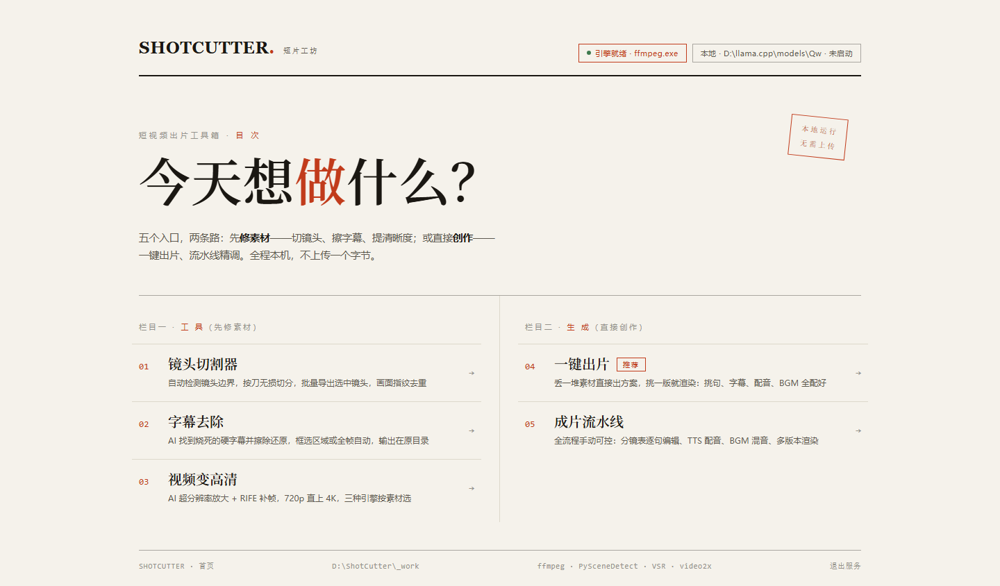
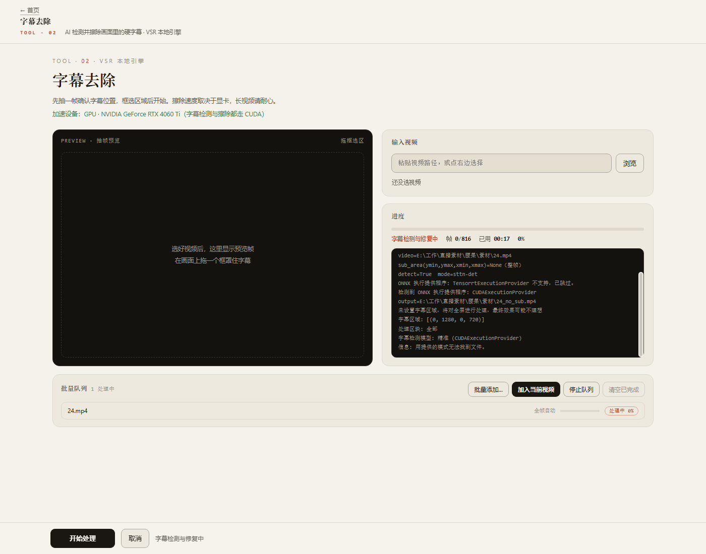
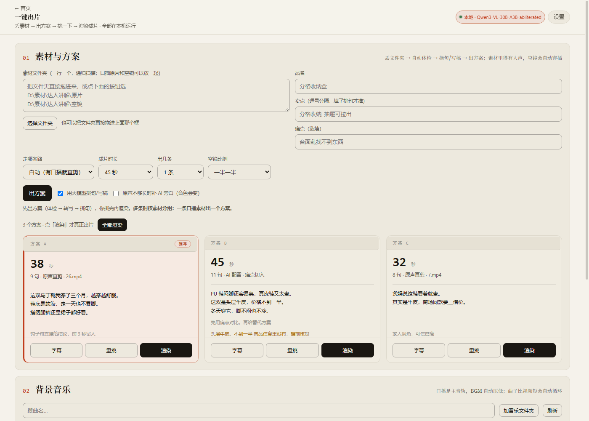
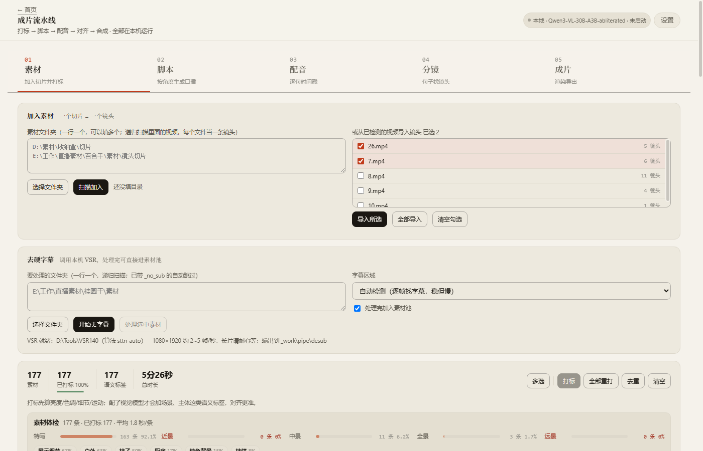

<div align="center">



# ShotCutter · 短视频出片工具箱

**把「长视频 → 切片 → 字幕 → 脚本 → 配音配乐 → 成片」串成一条本地流水线。**

[](https://www.python.org/)
[](#)
[](#)
[](https://github.com/LZM-KFFG/ShotCutter/releases)
[](LICENSE)
[](#版权与商业授权)

</div>

> 素材、模型、成片全部留在本机，不上传云端。除了「在线曲库」和可选的大模型，其余功能断网也能跑。

---

## 这是什么

一个跑在本机的 Web 工具集，浏览器就是界面。它不生产素材，只负责把**你手里的素材**整理成能发的短视频：

- 一条 40 分钟的长视频，切成几百个镜头，挑出能用的
- 一条带硬字幕的搬运素材，把字幕擦干净
- 一条 720p 的老素材，放大到 4K 并补帧
- 一堆口播 + 空镜，自动剪成十几条不同角度的成片

全部操作在 `http://127.0.0.1:8777` 完成，服务用 Python 标准库起，没有数据库、没有账号、没有云端队列。

## 界面

| 首页（目次） | 字幕去除（批量队列） |
|---|---|
|  |  |

| 一键出片（方案卡） | 成片流水线（素材页） |
|---|---|
|  |  |

## 核心能力

### 工具

| 模块 | 能做什么 |
|---|---|
| **镜头切割器** | PySceneDetect 四种检测器（内容 / 自适应 / 直方图 / 感知哈希），调阈值和最短镜头后切分；**无损流拷贝**（几秒完成、画质零损失）或**逐帧精确**；拖拽/多选批量摄入，画面指纹去重，导出到源目录 `镜头切片/` |
| **字幕去除** | 接本机 [VSR](https://github.com/YaoFANGUK/video-subtitle-remover) 擦除硬字幕；抽一帧预览后**直接在画面上拖框**罩住字幕，也有底部 30% / 顶部 30% / 全帧自动三个预设；**批量队列**一次挑多个视频串行处理，区域按各视频自身分辨率换算，跑完自动接下一个 |
| **视频变高清** | 接本机 [video2x](https://github.com/k4yt3x/video2x)；超分模型（Real-ESRGAN / Real-CUGAN / libplacebo 等）+ RIFE 补帧，倍数、编码器（NVENC）、画质可调，进度与日志实时回显 |

### 生成

| 模块 | 能做什么 |
|---|---|
| **一键出片** | 丢一堆素材 → 自动体检分流（口播 / 空镜）→ faster-whisper 转写 → 挑句 → 重算时间轴 → 按句配画面 → 出 3 条不同方案。**A 路线原声直剪**（不改句子顺序、一句一镜、口型对齐），**B 路线 AI 写稿配音**（14 种带货角度）。支持素材体检与**临时排除**、字幕预览、黄色标题字幕可调、BGM 曲库与混音试听、随时停止 |
| **成片流水线** | 五步手动挡：素材池（指纹去重、画面打标、批量移出）→ 脚本（分镜表逐句编辑）→ 分镜 → 配音 / BGM → 渲染。渲染完自动成片体检（黑边、字幕超宽、静音段、音量、首尾黑场、码率），成片列表支持多选打包下载、批量体检、批量删除 |

### 通用

- **BGM 曲库**：本地目录扫描 + 曲名搜索 + 行内试听 / 混音试听（用当前脚本配音混 20 秒）；**在线找曲**接 [Incompetech](https://incompetech.com/music/royalty-free/)（Kevin MacLeod，CC-BY 4.0），一键下载入库并自动生成署名对照表
- **字幕**：长句自动拆成多条单行字幕（优先在标点处断），渲染前可预览任意时刻画面，黄色标题字幕的文案 / 时长 / 字号 / 开关都能改
- **随时停止**：出方案、渲染、去字幕都能中断，已完成的产物保留
- **纸墨朱砂主题**：暖纸底 + 衬线标题 + 等宽数字，视频区一律进暗色「暗版」，长时间盯屏不刺眼

## 快速开始

**环境要求**：Windows 10/11、Python 3.12 或 3.13、ffmpeg。

```bat
git clone https://github.com/LZM-KFFG/ShotCutter.git
cd ShotCutter
install.bat        :: 建 .venv + 装依赖（首次 3~8 分钟）
启动.bat            :: 启动服务并打开浏览器
```

默认地址 `http://127.0.0.1:8777`；端口被占用时会自动往后顺延，实际端口看控制台。

**ffmpeg 放哪**：程序会依次找 `.venv\Scripts\ffmpeg.exe`、`tools\ffmpeg.exe`、项目根目录，最后找 PATH。最省事的做法是把 `ffmpeg.exe` 拷进 `.venv\Scripts\`。

## 可选组件

这三个都不装也能用，装了对应页面才会亮：

| 组件 | 用途 | 怎么接 |
|---|---|---|
| **VSR** | 字幕去除 | 下载 [video-subtitle-remover](https://github.com/YaoFANGUK/video-subtitle-remover)，把路径填进 `pipeline.json` 的 `desub.root`（指向含 `Python\python.exe` 和 `resources\run_with_area.py` 的目录） |
| **video2x** | 视频变高清 | 同上，填 `upscale.root`（指向含 `tools\video2x.exe` 的目录）；也可以直接把文件夹放到 `tools\VideoUpscaler` |
| **本地大模型** | 写稿 / 挑句 | 用 [llama.cpp](https://github.com/ggml-org/llama.cpp) 起一个 OpenAI 兼容服务，在页面「设置」里填地址和模型名 |

> 没有 NVIDIA 显卡也能跑：转写会自动回落 CPU（速度约为 GPU 的 1/4），字幕去除与视频变高清会提示缺少引擎。

## 换电脑 / 打包

```bat
.venv\Scripts\python.exe pack.py --exe          :: 便携安装包（需先装 Python，约 1.5GB）
.venv\Scripts\python.exe pack.py --only-embed   :: 免安装版（自带 Python 运行时，约 2.6GB）
```

- **便携安装包**：新电脑装好 Python 后双击 `安装.bat`，1 分钟离线装完
- **免安装版**：连 Python 都不用装，双击 `ShotCutter.exe` 直接起服务并打开浏览器；退出用网页页脚的「退出服务」或 `ShotCutter.exe --stop`

两个包都**不带** `_work`（素材池、项目、成片），也不带 VSR / video2x 这两个体积很大的可选工具。

## 工作原理

```
浏览器（原生 HTML/CSS/JS，无框架）
        │  HTTP  127.0.0.1:8777
        ▼
app.py ── 路由 / 任务队列 / 文件选择 / 静态文件 / 退出管理
   ├── pipeline.py      素材池、分镜脚本、字幕、渲染、BGM、成片体检
   ├── director.py      一键出片：体检分流 → 转写 → 挑句 → 时间轴 → 画面匹配
   ├── qc.py            成片体检规则
   └── vsr_runner.py    字幕去除的命令行封装
        │
        ├── ffmpeg / ffprobe        切、拼、混音、烧字幕、抽帧
        ├── PySceneDetect           镜头检测
        ├── faster-whisper          口播转写（GPU 优先，CPU 兜底）
        ├── edge-tts                AI 配音
        ├── VSR（可选）              硬字幕擦除
        └── video2x（可选）          超分 + 补帧
```

一键出片的核心思路是「**先定声音，再配画面**」：先把口播整理成一条干净的人声轨，画面、字幕都围绕这条音轨编排。原声路线里每个切点都有「文件 + 起止时间」的指纹，画面只能挑回它自己那一刀，所以口型和源片硬字幕不会错位。

## 配置

`pipeline.json` 第一次保存设置时自动生成（含本机路径，已加入 `.gitignore`）。几个常用的：

| 段 | 键 | 说明 |
|---|---|---|
| `video` | `w` `h` `fps` `crf` `preset` | 输出画幅与编码质量 |
| `video` | `sub_size` `sub_margin` `sub_max_chars` | 字幕字号、距底边比例、单行字数上限 |
| `video` | `hook` `hook_text` `hook_dur` `hook_size` | 黄色标题字幕的开关、文案、时长、字号 |
| `video` | `bgm_dirs` `bgm` `bgm_vol` | BGM 目录、默认曲目、音量 |
| `director` | `asr_model` `asr_device` `asr_compute` | 转写模型与设备（`cuda` / `cpu`） |
| `desub` / `upscale` | `root` | 可选工具路径 |

## 目录结构

```
ShotCutter/
├─ app.py            HTTP 服务与全部接口
├─ pipeline.py       素材池 / 分镜 / 字幕 / 渲染 / 体检
├─ director.py       一键出片导演
├─ qc.py             成片体检
├─ vsr_runner.py     字幕去除封装
├─ launch.py         启动入口（找端口、开浏览器）
├─ launcher.py       桌面启动器（打包成 exe）
├─ pack.py           打包脚本（便携版 / 免安装版）
├─ web/              六个页面（home / index / sub / hd / one / pipe）
├─ samples/          演示素材
├─ docs/images/      README 截图
├─ install.bat       首次安装
├─ 启动.bat           日常启动
├─ LICENSE           AGPL-3.0 协议原文
├─ CLA.md            贡献者许可协议
└─ requirements.txt
```

## 技术栈

| 层 | 用的什么 |
|---|---|
| 后端 | Python 3.13、标准库 `http.server`（没有 Flask / FastAPI，依赖少、启动快） |
| 前端 | 原生 HTML + CSS + JavaScript，零构建、零框架 |
| 视频 | ffmpeg / ffprobe |
| 检测与识别 | PySceneDetect、faster-whisper（CTranslate2） |
| 语音 | edge-tts |
| 可选 | VSR（PyTorch + ONNX Runtime）、video2x（Vulkan / RIFE） |

## 常见问题

**提示「没装转录引擎 faster-whisper」**
九成是用了系统 Python 启动，而不是项目的 `.venv`。用 `启动.bat`（或 `.venv\Scripts\python.exe app.py`）就不会。

**字幕去除看起来在用 CPU**
Windows 任务管理器的 GPU 图默认显示 3D 引擎，CUDA 工作在另一个引擎里。切到「Cuda / Compute」看，或者看 `nvidia-smi`。页面头部与任务日志第一行都会打印实际用的设备。

**抽帧是黑的 / 抽不出帧**
多半是素材本身没下载完整（判据：体积 ≈ 时长 × 码率 ÷ 8）。程序会自动退到能解码的时间点并提示「已用 X 秒的画面」，残片建议重新导出。

**端口被占用**
服务会从 8777 往后找可用端口，控制台会打印实际地址。

**中文显示成乱码**
用 `启动.bat`（内含 `chcp 65001`）。子进程日志已做 UTF-8 / GBK 自适应解码。

## 说明与致谢

- 本项目只做本地处理，不提供任何素材、成片或绕过平台规则的能力，请用于**自有或已授权素材**的剪辑
- 在线 BGM 来自 [Incompetech](https://incompetech.com/music/royalty-free/)，作者 **Kevin MacLeod**，协议 **CC BY 4.0**；下载入库时会自动生成 `BGM 署名对照.txt`，发布视频时请照此署名
- 感谢这些开源项目：[ffmpeg](https://ffmpeg.org/)、[PySceneDetect](https://github.com/Breakthrough/PySceneDetect)、[faster-whisper](https://github.com/SYSTRAN/faster-whisper)、[CTranslate2](https://github.com/OpenNMT/CTranslate2)、[edge-tts](https://github.com/rany2/edge-tts)、[video-subtitle-remover](https://github.com/YaoFANGUK/video-subtitle-remover)、[video2x](https://github.com/k4yt3x/video2x)、[llama.cpp](https://github.com/ggml-org/llama.cpp)

## 许可证

[GNU AGPL-3.0](LICENSE)

可以自由使用、修改、分发（包括商用），但有两条例外：

- **分发修改版必须以 AGPL-3.0 开源**，并保留版权声明与协议文本
- **把修改版做成网络服务**（SaaS / 在线版）时，同样必须向使用者提供完整源码

> 之所以选 AGPL 而不是 MIT：项目依赖的 `edge-tts` 本身是 GPL-3.0，用 AGPL 与它协议兼容；同时能避免有人改个名字就闭源转卖。

## 版权与商业授权

**Copyright (c) 2026 LZM-KFFG. All rights reserved.**

- 本项目的著作权归作者所有。AGPL-3.0 授予的是**开源使用**的权利，不包含闭源分发或闭源商用的许可。
- 如果你的公司或产品需要**闭源集成 / 闭源分发 / OEM 贴牌 / 私有部署**，需要单独获取商业授权（双许可）。可以通过仓库 Issues 或作者 GitHub 主页联系，标题注明「商业授权」。
- 商业授权不改变社区版：社区版始终以 AGPL-3.0 提供，功能与更新不受影响。

## 贡献

欢迎提 Issue 反馈 bug、提需求、报兼容性问题。

**代码 PR 需要先签署[贡献者许可协议（CLA）](CLA.md)**。原因很直接：项目要保留商业双许可的可能，版权必须集中；如果有未授权的第三方代码进来，以后想换许可证就换不成了。PR 里加一行声明即可，见 CLA 第 7 节。
